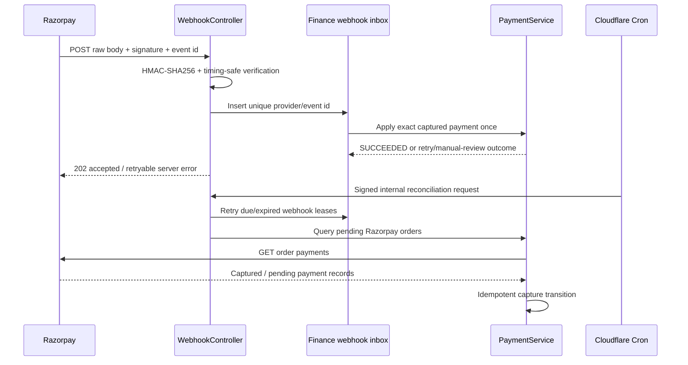

# Payment Module — Implementation Documentation

This document describes the payment implementation as it exists in this branch. Code and migration SQL are authoritative.

## 1. Scope and safety boundary

The module supports booking-scoped payment intents, Razorpay order creation and server-side capture verification, signed webhook ingestion, and scheduled recovery of pending orders. It does **not** make public collection safe by itself: the staging/provider-first pilot must keep `PILOT_DISABLE_COLLECTIONS=true` until gateway sandbox E2E, refund/payout workflows, finance sign-off and UAT are complete.

Gateway selection is fail-closed:
- `razorpay`: real Razorpay adapter; requires API credentials, webhook secret and reconciliation cron secret in staging/production.
- `stub`: development/test only; forbidden in staging/production.
- `disabled`: safe staging/production default when no live provider is explicitly configured.

The collection-disable guard blocks new cash/online intents, browser verification and provider cash confirmation. Signed gateway webhooks remain active so an already-created real order can still be reconciled after collection is disabled.

## 2. File map

```text
src/payment/
├── payment.module.ts
├── payment.service.ts
├── payment.service.spec.ts
├── customer/customer-payment.controller.ts
├── provider/provider-payment.controller.ts
├── gateway/
│   ├── payment-gateway.interface.ts
│   ├── razorpay-payment.gateway.ts
│   ├── razorpay-payment.gateway.spec.ts
│   ├── stub-payment.gateway.ts
│   └── disabled-payment.gateway.ts
├── razorpay-webhook.controller.ts
├── razorpay-webhook.service.ts
├── razorpay-webhook.service.spec.ts
├── payment-reconciliation.controller.ts
└── dto/
```

The Cloudflare scheduled worker is under `infra/cloudflare/payment-reconciliation-cron/`.

## 3. Persistence

`Payment` is one-to-many with `Booking`. The booking-scoped advisory transaction lock and serializable reservation prevent concurrent intents from reserving more than the immutable tax-inclusive total. `clientRequestId` is unique per booking.

`PaymentWebhookEvent` is an inbox/outbox-style processing record in the finance schema:
- unique `(provider, event_id)` prevents replayed gateway events from applying twice;
- only sanitized gateway identifiers, status, amount and currency are retained in JSON;
- `RECEIVED → PROCESSING → PROCESSED` is the successful path;
- transient failures become `RETRYABLE` with exponential backoff and a lease;
- permanent mismatches or exhausted retries become `DEAD` for manual review.

The original raw body and signature are never persisted. The signature is checked against the untouched raw request bytes before the event is stored.

## 4. Capture state machine

The browser verification path, webhook path and scheduled reconciliation all converge on `PaymentService.confirmCapturedFromGateway`.

That transition:
1. looks up the local payment by the unique gateway order id;
2. requires an ONLINE intent and exact amount in paise plus exact currency;
3. returns success if the same gateway payment id was already recorded;
4. atomically changes INITIATED or recoverable FAILED to SUCCEEDED only when no payment id has already won; and
5. rejects a different successful capture instead of overwriting it.

A late capture can therefore recover an order that a client previously displayed as failed. An invalid browser signature never mutates the payment. A `payment.failed` webhook does not fail the whole order-level intent because another payment attempt may still succeed.

## 5. Webhook and recovery sequence



The internal reconciliation endpoint has a separate high-entropy secret, HMAC timestamp and five-minute replay window. It is not a JWT endpoint and must never be exposed to clients.

## 6. Configuration

| Variable | Purpose |
|---|---|
| `PAYMENT_PROVIDER` | `razorpay`, `stub` or `disabled` |
| `RAZORPAY_KEY_ID` | Server-side Razorpay API key id |
| `RAZORPAY_KEY_SECRET` | Server-side Razorpay API secret |
| `RAZORPAY_WEBHOOK_SECRET` | HMAC verification secret configured in Razorpay webhook settings |
| `PAYMENT_RECONCILIATION_CRON_SECRET` | 32+ character secret shared only by API and scheduled Worker |
| `PILOT_DISABLE_COLLECTIONS` | Blocks new customer/provider collection actions when `true` |

Never put gateway secrets in Next.js public environment variables, Expo config, logs, or client bundles.

## 7. Remaining work / production gates

- Add audited operator review and replay for `DEAD` webhook rows, with alerts and ownership.
- Record and resolve multiple captured payments for one order through an auditable financial exception workflow.
- Implement real refund API integration, partial refund ledger, refund webhook reconciliation and safe retry.
- Implement real payout integration, provider-account verification, payout idempotency and payout recovery.
- Add transactionally produced business outbox events and connect notification delivery to booking/payment state changes.
- Complete sandbox E2E with actual Razorpay test credentials, concurrency/race tests and failure injection.
- Complete finance/legal review, customer quote acceptance, provider/customer cash-vs-online UAT and production secret provisioning.

The scheduled worker and code are implemented here; they are **not operational** until deployed and provisioned with secrets. No live-money or launch-readiness claim is implied.
