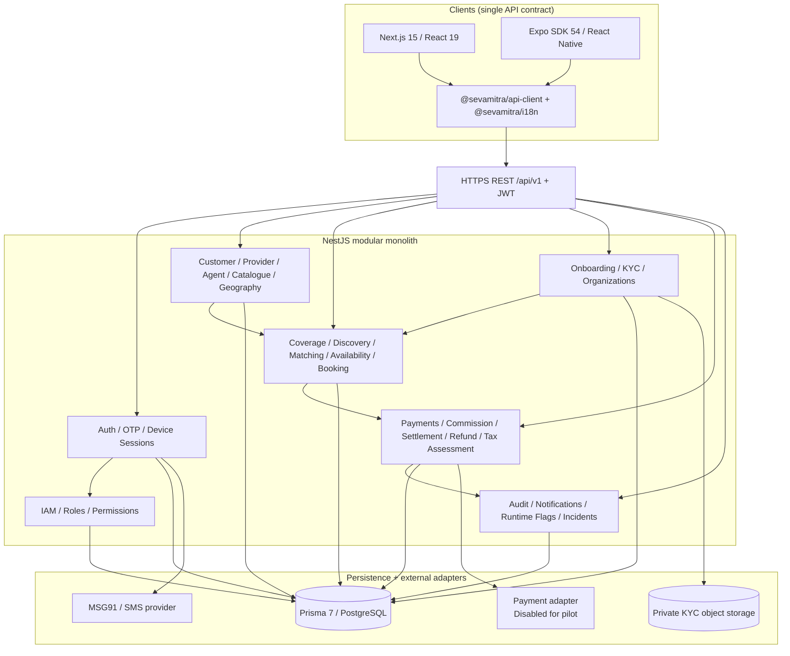
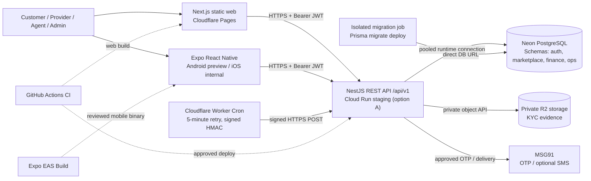
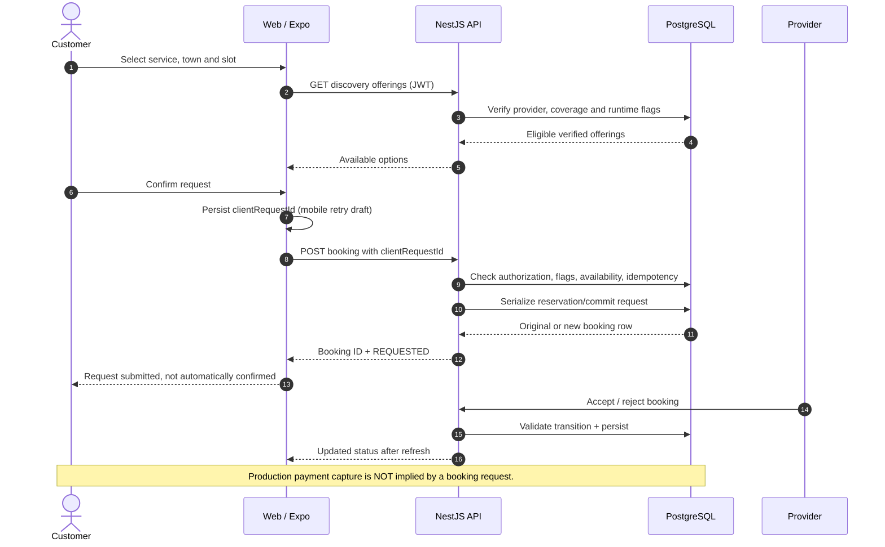

# SevaMitra architecture — implementation-grounded technical reference

**Snapshot:** 10 November 2026, `develop` at `e6dbddcf84d0`. The enhanced UI/security candidate is open in PR #38; tax/dynamic-pricing/billing is open in PR #37 and **not** part of the baseline. This document describes the repository, not a verified running production service.

## 1. Executive summary
SevaMitra is a **modular monolith**: NestJS 11 exposes REST APIs, Prisma 7 accesses PostgreSQL 16-compatible schemas, Next.js 15 statically exports the web, and Expo SDK 54 ships one role-aware mobile application. It is **not** a microservice deployment, not a completed offline-first system, and not a production-certified payment processor.

## 2. Domains and authorization
| Domain | Backend ownership | Data schema |
|---|---|---|
| Identity and permissions | Auth, IAM, trusted device/OTP | `auth` |
| People and services | Customer, Provider, Agent, Catalogue, Geography, Organization, Onboarding | `marketplace` |
| Fulfilment | Coverage, Discovery, Matching, Availability, Booking | `marketplace` |
| Financial records | Payment, Refund, Commission, Settlement, Tax Assessment | `finance` |
| Operations | Audit, Notification, Push Device, Runtime Flags, Incident | `ops` |

JWT authenticates each request; service/controller guards also authorize operations. Role menu visibility never constitutes server authorization. Area/organization-scoped permissions must not be confused with platform-wide grants.

## 3. Runtime and build layout
- `apps/backend/`: NestJS, HTTP v1 under `/api/v1`; health endpoints are version-neutral `/api/health` and `/api/health/db`.
- `apps/backend/prisma/schema.prisma`: authoritative Prisma models, with `auth`, `marketplace`, `finance` and `ops` schemas.
- `apps/backend/prisma/migrations/`: immutable, ordered PostgreSQL migration history.
- `apps/web/`: Next.js static export (`apps/web/out`), client-side API calls; no Next.js runtime server is needed in Pages for current routes.
- `apps/mobile/`: Expo Router app, Android internal APK (EAS preview) versus Android App Bundle (EAS production).
- `packages/api-client/` and `packages/i18n/`: shared frontend networking and translation packages.
- `apps/backend/infra/cloudflare/notification-cron/`: periodic signed call to the notification outbox retry endpoint (every 5 minutes).

## 4. Deployment options — alternatives, not simultaneous requirements
The repository supports a controlled **Cloud Run + Neon + Cloudflare Pages + EAS + private R2** staging route; AWS EC2 + Docker Compose + ECR + SSM is an alternative. The former is the documented low-cost pilot option, **not a guarantee of zero cloud spend**. The actual active staging environment, secrets, DNS, costs and deployment state must be confirmed by the operator.

**AWS alternative:** see [deployment topology](handbook/DEPLOYMENT_TOPOLOGY.md). Use managed DB and independently validated backups before holding customer/financial data.

## 5. Primary customer booking flow

A booking is initially REQUESTED; provider acceptance is a separate state transition. Mobile retry keys are account-bound, persisted and manually replayable. The full offline provider/agent queue remains open in issue #5. Discovery/booking flag enforcement and atomic onboarding review improvements are in PR #38 and must be merged/deployed before they are relied upon in staging.

## 6. Security and sensitive data
- Explicit CORS HTTPS allowlist for browser origins in shared environments; native requests use the same JWT authentication model.
- Validated DTOs, throttling, privileged IAM checks, private KYC object storage and bounded signed notification cron access.
- Audit data is append-only for the application database role via an `ops.audit_log` trigger, **not tamper-proof against database administrators**.
- No secrets in git, browser `NEXT_PUBLIC_*`, Expo `EXPO_PUBLIC_*` or logs.
- Runtime payment, refund and payout adapters must stay disabled for the provider-first pilot until formal finance and gateway reconciliation sign-off.
- User-facing error redaction improvements are in PR #38; audit current staging before asserting they are live.

## 7. Non-delivered capabilities and decisions
Issue [#3](https://github.com/bv-prasanna/SevaMitra/issues/3): gateway webhook/refund/payout reconciliation.
Issue [#4](https://github.com/bv-prasanna/SevaMitra/issues/4): incident SLA scheduler and document expiry.
Issue [#5](https://github.com/bv-prasanna/SevaMitra/issues/5): complete offline role-scoped sync.
Issue [#6](https://github.com/bv-prasanna/SevaMitra/issues/6): privacy/legal policy, fraud, scoped operational access and incident policy.
PR [#37](https://github.com/bv-prasanna/SevaMitra/pull/37) contains **proposed** additional tax, invoice, pricing and schema changes; do not claim those tables exist in `develop`.

## 8. Related operator documentation
Read [handover pack](handbook/README.md), [ER diagrams](handbook/ER_DIAGRAMS.md), [database catalogue](handbook/DATABASE_CATALOG.md), [migrations](handbook/MIGRATIONS.md), [deployment](handbook/DEPLOYMENT_TOPOLOGY.md), [operations](handbook/OPERATIONS_RUNBOOK.md), [KT](handbook/KT_DEMO.md), [API reference](handbook/API_REFERENCE.md), [technical decisions](handbook/TECHNICAL_DECISIONS.md), and [UAT release gates](handbook/UAT_RELEASE.md). Existing [deployment runbook](DEPLOYMENT_RUNBOOK.md) and [low-cost pilot guide](LOW_COST_PILOT_RELEASE.md) remain the detailed references for the supported staging alternatives.

