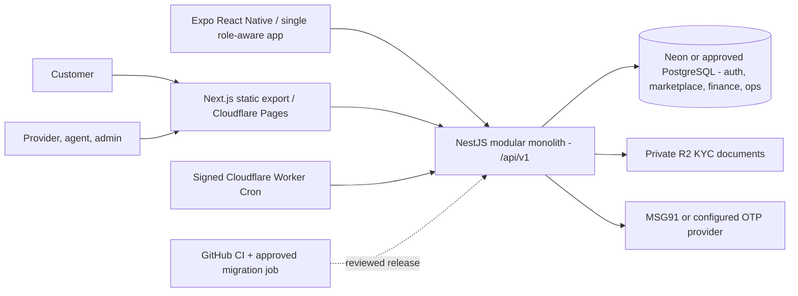

# SevaMitra: code-recovered architecture and deployment handover

> **Baseline recovered 10 November 2026:** [`develop` `e6dbddcf84d0`](https://github.com/bv-prasanna/SevaMitra/tree/e6dbddcf84d0d30681b390025fae1f684413668e) (548 source files). **Do not equate branch contents with the main branch or deployed release.** Earlier `main`-only reports of absent source are superseded by this branch recovery.

## System context

This is a **reference architecture from source/docs**, not confirmation that all services have been deployed. `develop` also contains an [alternative EC2/Compose runbook](https://github.com/bv-prasanna/SevaMitra/blob/e6dbddcf84d0d30681b390025fae1f684413668e/docs/DEPLOYMENT_RUNBOOK.md); choose one documented deployment model per environment.

## NestJS modules (25 actual files)
- [`apps/backend/src/agent/agent.module.ts`](https://github.com/bv-prasanna/SevaMitra/blob/e6dbddcf84d0d30681b390025fae1f684413668e/apps/backend/src/agent/agent.module.ts)
- [`apps/backend/src/app.module.ts`](https://github.com/bv-prasanna/SevaMitra/blob/e6dbddcf84d0d30681b390025fae1f684413668e/apps/backend/src/app.module.ts)
- [`apps/backend/src/audit/audit.module.ts`](https://github.com/bv-prasanna/SevaMitra/blob/e6dbddcf84d0d30681b390025fae1f684413668e/apps/backend/src/audit/audit.module.ts)
- [`apps/backend/src/auth/auth.module.ts`](https://github.com/bv-prasanna/SevaMitra/blob/e6dbddcf84d0d30681b390025fae1f684413668e/apps/backend/src/auth/auth.module.ts)
- [`apps/backend/src/availability/availability.module.ts`](https://github.com/bv-prasanna/SevaMitra/blob/e6dbddcf84d0d30681b390025fae1f684413668e/apps/backend/src/availability/availability.module.ts)
- [`apps/backend/src/booking/booking.module.ts`](https://github.com/bv-prasanna/SevaMitra/blob/e6dbddcf84d0d30681b390025fae1f684413668e/apps/backend/src/booking/booking.module.ts)
- [`apps/backend/src/catalogue/catalogue.module.ts`](https://github.com/bv-prasanna/SevaMitra/blob/e6dbddcf84d0d30681b390025fae1f684413668e/apps/backend/src/catalogue/catalogue.module.ts)
- [`apps/backend/src/commission/commission.module.ts`](https://github.com/bv-prasanna/SevaMitra/blob/e6dbddcf84d0d30681b390025fae1f684413668e/apps/backend/src/commission/commission.module.ts)
- [`apps/backend/src/customer/customer.module.ts`](https://github.com/bv-prasanna/SevaMitra/blob/e6dbddcf84d0d30681b390025fae1f684413668e/apps/backend/src/customer/customer.module.ts)
- [`apps/backend/src/geography/geography.module.ts`](https://github.com/bv-prasanna/SevaMitra/blob/e6dbddcf84d0d30681b390025fae1f684413668e/apps/backend/src/geography/geography.module.ts)
- [`apps/backend/src/health/health.module.ts`](https://github.com/bv-prasanna/SevaMitra/blob/e6dbddcf84d0d30681b390025fae1f684413668e/apps/backend/src/health/health.module.ts)
- [`apps/backend/src/iam/iam.module.ts`](https://github.com/bv-prasanna/SevaMitra/blob/e6dbddcf84d0d30681b390025fae1f684413668e/apps/backend/src/iam/iam.module.ts)
- [`apps/backend/src/incident/incident.module.ts`](https://github.com/bv-prasanna/SevaMitra/blob/e6dbddcf84d0d30681b390025fae1f684413668e/apps/backend/src/incident/incident.module.ts)
- [`apps/backend/src/notification/notification.module.ts`](https://github.com/bv-prasanna/SevaMitra/blob/e6dbddcf84d0d30681b390025fae1f684413668e/apps/backend/src/notification/notification.module.ts)
- [`apps/backend/src/payment/payment.module.ts`](https://github.com/bv-prasanna/SevaMitra/blob/e6dbddcf84d0d30681b390025fae1f684413668e/apps/backend/src/payment/payment.module.ts)
- [`apps/backend/src/prisma/prisma.module.ts`](https://github.com/bv-prasanna/SevaMitra/blob/e6dbddcf84d0d30681b390025fae1f684413668e/apps/backend/src/prisma/prisma.module.ts)
- [`apps/backend/src/provider-offering/provider-offering.module.ts`](https://github.com/bv-prasanna/SevaMitra/blob/e6dbddcf84d0d30681b390025fae1f684413668e/apps/backend/src/provider-offering/provider-offering.module.ts)
- [`apps/backend/src/provider-onboarding/provider-onboarding.module.ts`](https://github.com/bv-prasanna/SevaMitra/blob/e6dbddcf84d0d30681b390025fae1f684413668e/apps/backend/src/provider-onboarding/provider-onboarding.module.ts)
- [`apps/backend/src/provider-organization/organization.module.ts`](https://github.com/bv-prasanna/SevaMitra/blob/e6dbddcf84d0d30681b390025fae1f684413668e/apps/backend/src/provider-organization/organization.module.ts)
- [`apps/backend/src/provider/provider.module.ts`](https://github.com/bv-prasanna/SevaMitra/blob/e6dbddcf84d0d30681b390025fae1f684413668e/apps/backend/src/provider/provider.module.ts)
- [`apps/backend/src/refund/refund.module.ts`](https://github.com/bv-prasanna/SevaMitra/blob/e6dbddcf84d0d30681b390025fae1f684413668e/apps/backend/src/refund/refund.module.ts)
- [`apps/backend/src/runtime-flags/runtime-flags.module.ts`](https://github.com/bv-prasanna/SevaMitra/blob/e6dbddcf84d0d30681b390025fae1f684413668e/apps/backend/src/runtime-flags/runtime-flags.module.ts)
- [`apps/backend/src/serviceability/serviceability.module.ts`](https://github.com/bv-prasanna/SevaMitra/blob/e6dbddcf84d0d30681b390025fae1f684413668e/apps/backend/src/serviceability/serviceability.module.ts)
- [`apps/backend/src/settlement/settlement.module.ts`](https://github.com/bv-prasanna/SevaMitra/blob/e6dbddcf84d0d30681b390025fae1f684413668e/apps/backend/src/settlement/settlement.module.ts)
- [`apps/backend/src/tax/tax.module.ts`](https://github.com/bv-prasanna/SevaMitra/blob/e6dbddcf84d0d30681b390025fae1f684413668e/apps/backend/src/tax/tax.module.ts)

## HTTP controller source inventory (57 files)
Controller files, not a claim that all routes are reachable in production. For exact method, URI and DTO, use [generated OpenAPI](https://github.com/bv-prasanna/SevaMitra/blob/e6dbddcf84d0d30681b390025fae1f684413668e/apps/backend/docs/api/openapi.json) and [API reference](https://github.com/bv-prasanna/SevaMitra/blob/4b32987d46e7cb6e7e4ec0b2927c4f75b5ed64fd/docs/handbook/API_REFERENCE.md).
- [`apps/backend/src/agent/admin-operations.controller.ts`](https://github.com/bv-prasanna/SevaMitra/blob/e6dbddcf84d0d30681b390025fae1f684413668e/apps/backend/src/agent/admin-operations.controller.ts)
- [`apps/backend/src/agent/agent-admin.controller.ts`](https://github.com/bv-prasanna/SevaMitra/blob/e6dbddcf84d0d30681b390025fae1f684413668e/apps/backend/src/agent/agent-admin.controller.ts)
- [`apps/backend/src/agent/agent.controller.ts`](https://github.com/bv-prasanna/SevaMitra/blob/e6dbddcf84d0d30681b390025fae1f684413668e/apps/backend/src/agent/agent.controller.ts)
- [`apps/backend/src/agent/company/agent-company.controller.ts`](https://github.com/bv-prasanna/SevaMitra/blob/e6dbddcf84d0d30681b390025fae1f684413668e/apps/backend/src/agent/company/agent-company.controller.ts)
- [`apps/backend/src/audit/audit.controller.ts`](https://github.com/bv-prasanna/SevaMitra/blob/e6dbddcf84d0d30681b390025fae1f684413668e/apps/backend/src/audit/audit.controller.ts)
- [`apps/backend/src/auth/auth.controller.ts`](https://github.com/bv-prasanna/SevaMitra/blob/e6dbddcf84d0d30681b390025fae1f684413668e/apps/backend/src/auth/auth.controller.ts)
- [`apps/backend/src/auth/trusted-device.controller.ts`](https://github.com/bv-prasanna/SevaMitra/blob/e6dbddcf84d0d30681b390025fae1f684413668e/apps/backend/src/auth/trusted-device.controller.ts)
- [`apps/backend/src/auth/workspace.controller.ts`](https://github.com/bv-prasanna/SevaMitra/blob/e6dbddcf84d0d30681b390025fae1f684413668e/apps/backend/src/auth/workspace.controller.ts)
- [`apps/backend/src/availability/check/check.controller.ts`](https://github.com/bv-prasanna/SevaMitra/blob/e6dbddcf84d0d30681b390025fae1f684413668e/apps/backend/src/availability/check/check.controller.ts)
- [`apps/backend/src/availability/exception/exception.controller.ts`](https://github.com/bv-prasanna/SevaMitra/blob/e6dbddcf84d0d30681b390025fae1f684413668e/apps/backend/src/availability/exception/exception.controller.ts)
- [`apps/backend/src/availability/schedule/schedule.controller.ts`](https://github.com/bv-prasanna/SevaMitra/blob/e6dbddcf84d0d30681b390025fae1f684413668e/apps/backend/src/availability/schedule/schedule.controller.ts)
- [`apps/backend/src/availability/working-hours/working-hours.controller.ts`](https://github.com/bv-prasanna/SevaMitra/blob/e6dbddcf84d0d30681b390025fae1f684413668e/apps/backend/src/availability/working-hours/working-hours.controller.ts)
- [`apps/backend/src/booking/customer/customer-booking.controller.ts`](https://github.com/bv-prasanna/SevaMitra/blob/e6dbddcf84d0d30681b390025fae1f684413668e/apps/backend/src/booking/customer/customer-booking.controller.ts)
- [`apps/backend/src/booking/provider/provider-booking.controller.ts`](https://github.com/bv-prasanna/SevaMitra/blob/e6dbddcf84d0d30681b390025fae1f684413668e/apps/backend/src/booking/provider/provider-booking.controller.ts)
- [`apps/backend/src/catalogue/category/category.controller.ts`](https://github.com/bv-prasanna/SevaMitra/blob/e6dbddcf84d0d30681b390025fae1f684413668e/apps/backend/src/catalogue/category/category.controller.ts)
- [`apps/backend/src/catalogue/service/service.controller.ts`](https://github.com/bv-prasanna/SevaMitra/blob/e6dbddcf84d0d30681b390025fae1f684413668e/apps/backend/src/catalogue/service/service.controller.ts)
- [`apps/backend/src/catalogue/variant/variant.controller.ts`](https://github.com/bv-prasanna/SevaMitra/blob/e6dbddcf84d0d30681b390025fae1f684413668e/apps/backend/src/catalogue/variant/variant.controller.ts)
- [`apps/backend/src/commission/calculation/commission-calculation.controller.ts`](https://github.com/bv-prasanna/SevaMitra/blob/e6dbddcf84d0d30681b390025fae1f684413668e/apps/backend/src/commission/calculation/commission-calculation.controller.ts)
- [`apps/backend/src/commission/calculation/provider/provider-commission.controller.ts`](https://github.com/bv-prasanna/SevaMitra/blob/e6dbddcf84d0d30681b390025fae1f684413668e/apps/backend/src/commission/calculation/provider/provider-commission.controller.ts)
- [`apps/backend/src/commission/rule/commission-rule.controller.ts`](https://github.com/bv-prasanna/SevaMitra/blob/e6dbddcf84d0d30681b390025fae1f684413668e/apps/backend/src/commission/rule/commission-rule.controller.ts)
- [`apps/backend/src/customer/address/address.controller.ts`](https://github.com/bv-prasanna/SevaMitra/blob/e6dbddcf84d0d30681b390025fae1f684413668e/apps/backend/src/customer/address/address.controller.ts)
- [`apps/backend/src/customer/customer.controller.ts`](https://github.com/bv-prasanna/SevaMitra/blob/e6dbddcf84d0d30681b390025fae1f684413668e/apps/backend/src/customer/customer.controller.ts)
- [`apps/backend/src/geography/district/district.controller.ts`](https://github.com/bv-prasanna/SevaMitra/blob/e6dbddcf84d0d30681b390025fae1f684413668e/apps/backend/src/geography/district/district.controller.ts)
- [`apps/backend/src/geography/state/state.controller.ts`](https://github.com/bv-prasanna/SevaMitra/blob/e6dbddcf84d0d30681b390025fae1f684413668e/apps/backend/src/geography/state/state.controller.ts)
- [`apps/backend/src/geography/taluk/taluk.controller.ts`](https://github.com/bv-prasanna/SevaMitra/blob/e6dbddcf84d0d30681b390025fae1f684413668e/apps/backend/src/geography/taluk/taluk.controller.ts)
- [`apps/backend/src/geography/town-village/town-village.controller.ts`](https://github.com/bv-prasanna/SevaMitra/blob/e6dbddcf84d0d30681b390025fae1f684413668e/apps/backend/src/geography/town-village/town-village.controller.ts)
- [`apps/backend/src/health/health.controller.ts`](https://github.com/bv-prasanna/SevaMitra/blob/e6dbddcf84d0d30681b390025fae1f684413668e/apps/backend/src/health/health.controller.ts)
- [`apps/backend/src/iam/assignment/role-assignment.controller.ts`](https://github.com/bv-prasanna/SevaMitra/blob/e6dbddcf84d0d30681b390025fae1f684413668e/apps/backend/src/iam/assignment/role-assignment.controller.ts)
- [`apps/backend/src/iam/permission/permission.controller.ts`](https://github.com/bv-prasanna/SevaMitra/blob/e6dbddcf84d0d30681b390025fae1f684413668e/apps/backend/src/iam/permission/permission.controller.ts)
- [`apps/backend/src/iam/role/role.controller.ts`](https://github.com/bv-prasanna/SevaMitra/blob/e6dbddcf84d0d30681b390025fae1f684413668e/apps/backend/src/iam/role/role.controller.ts)
- [`apps/backend/src/incident/incident.controller.ts`](https://github.com/bv-prasanna/SevaMitra/blob/e6dbddcf84d0d30681b390025fae1f684413668e/apps/backend/src/incident/incident.controller.ts)
- [`apps/backend/src/notification/admin-notification.controller.ts`](https://github.com/bv-prasanna/SevaMitra/blob/e6dbddcf84d0d30681b390025fae1f684413668e/apps/backend/src/notification/admin-notification.controller.ts)
- [`apps/backend/src/notification/notification-cron.controller.ts`](https://github.com/bv-prasanna/SevaMitra/blob/e6dbddcf84d0d30681b390025fae1f684413668e/apps/backend/src/notification/notification-cron.controller.ts)
- [`apps/backend/src/notification/notification.controller.ts`](https://github.com/bv-prasanna/SevaMitra/blob/e6dbddcf84d0d30681b390025fae1f684413668e/apps/backend/src/notification/notification.controller.ts)
- [`apps/backend/src/notification/push-device.controller.ts`](https://github.com/bv-prasanna/SevaMitra/blob/e6dbddcf84d0d30681b390025fae1f684413668e/apps/backend/src/notification/push-device.controller.ts)
- [`apps/backend/src/payment/customer/customer-payment.controller.ts`](https://github.com/bv-prasanna/SevaMitra/blob/e6dbddcf84d0d30681b390025fae1f684413668e/apps/backend/src/payment/customer/customer-payment.controller.ts)
- [`apps/backend/src/payment/provider/provider-payment.controller.ts`](https://github.com/bv-prasanna/SevaMitra/blob/e6dbddcf84d0d30681b390025fae1f684413668e/apps/backend/src/payment/provider/provider-payment.controller.ts)
- [`apps/backend/src/provider-offering/offering-browse.controller.ts`](https://github.com/bv-prasanna/SevaMitra/blob/e6dbddcf84d0d30681b390025fae1f684413668e/apps/backend/src/provider-offering/offering-browse.controller.ts)
- [`apps/backend/src/provider-offering/offering.controller.ts`](https://github.com/bv-prasanna/SevaMitra/blob/e6dbddcf84d0d30681b390025fae1f684413668e/apps/backend/src/provider-offering/offering.controller.ts)
- [`apps/backend/src/provider-onboarding/application-admin.controller.ts`](https://github.com/bv-prasanna/SevaMitra/blob/e6dbddcf84d0d30681b390025fae1f684413668e/apps/backend/src/provider-onboarding/application-admin.controller.ts)
- [`apps/backend/src/provider-onboarding/application.controller.ts`](https://github.com/bv-prasanna/SevaMitra/blob/e6dbddcf84d0d30681b390025fae1f684413668e/apps/backend/src/provider-onboarding/application.controller.ts)
- [`apps/backend/src/provider-organization/organization.controller.ts`](https://github.com/bv-prasanna/SevaMitra/blob/e6dbddcf84d0d30681b390025fae1f684413668e/apps/backend/src/provider-organization/organization.controller.ts)
- [`apps/backend/src/provider/provider.controller.ts`](https://github.com/bv-prasanna/SevaMitra/blob/e6dbddcf84d0d30681b390025fae1f684413668e/apps/backend/src/provider/provider.controller.ts)
- [`apps/backend/src/refund/policy/refund-policy.controller.ts`](https://github.com/bv-prasanna/SevaMitra/blob/e6dbddcf84d0d30681b390025fae1f684413668e/apps/backend/src/refund/policy/refund-policy.controller.ts)
- [`apps/backend/src/refund/process/customer/customer-refund.controller.ts`](https://github.com/bv-prasanna/SevaMitra/blob/e6dbddcf84d0d30681b390025fae1f684413668e/apps/backend/src/refund/process/customer/customer-refund.controller.ts)
- [`apps/backend/src/refund/process/refund.controller.ts`](https://github.com/bv-prasanna/SevaMitra/blob/e6dbddcf84d0d30681b390025fae1f684413668e/apps/backend/src/refund/process/refund.controller.ts)
- [`apps/backend/src/runtime-flags/runtime-flags.controller.ts`](https://github.com/bv-prasanna/SevaMitra/blob/e6dbddcf84d0d30681b390025fae1f684413668e/apps/backend/src/runtime-flags/runtime-flags.controller.ts)
- [`apps/backend/src/serviceability/check/check.controller.ts`](https://github.com/bv-prasanna/SevaMitra/blob/e6dbddcf84d0d30681b390025fae1f684413668e/apps/backend/src/serviceability/check/check.controller.ts)
- [`apps/backend/src/serviceability/coverage-area/coverage-area-admin.controller.ts`](https://github.com/bv-prasanna/SevaMitra/blob/e6dbddcf84d0d30681b390025fae1f684413668e/apps/backend/src/serviceability/coverage-area/coverage-area-admin.controller.ts)
- [`apps/backend/src/serviceability/coverage-area/coverage-area.controller.ts`](https://github.com/bv-prasanna/SevaMitra/blob/e6dbddcf84d0d30681b390025fae1f684413668e/apps/backend/src/serviceability/coverage-area/coverage-area.controller.ts)
- [`apps/backend/src/serviceability/coverage-profile/coverage-profile.controller.ts`](https://github.com/bv-prasanna/SevaMitra/blob/e6dbddcf84d0d30681b390025fae1f684413668e/apps/backend/src/serviceability/coverage-profile/coverage-profile.controller.ts)
- [`apps/backend/src/serviceability/discovery/discovery.controller.ts`](https://github.com/bv-prasanna/SevaMitra/blob/e6dbddcf84d0d30681b390025fae1f684413668e/apps/backend/src/serviceability/discovery/discovery.controller.ts)
- [`apps/backend/src/serviceability/matching/matching.controller.ts`](https://github.com/bv-prasanna/SevaMitra/blob/e6dbddcf84d0d30681b390025fae1f684413668e/apps/backend/src/serviceability/matching/matching.controller.ts)
- [`apps/backend/src/settlement/config/settlement-config.controller.ts`](https://github.com/bv-prasanna/SevaMitra/blob/e6dbddcf84d0d30681b390025fae1f684413668e/apps/backend/src/settlement/config/settlement-config.controller.ts)
- [`apps/backend/src/settlement/run/provider/provider-settlement.controller.ts`](https://github.com/bv-prasanna/SevaMitra/blob/e6dbddcf84d0d30681b390025fae1f684413668e/apps/backend/src/settlement/run/provider/provider-settlement.controller.ts)
- [`apps/backend/src/settlement/run/settlement.controller.ts`](https://github.com/bv-prasanna/SevaMitra/blob/e6dbddcf84d0d30681b390025fae1f684413668e/apps/backend/src/settlement/run/settlement.controller.ts)
- [`apps/backend/src/tax/tax-assessment.controller.ts`](https://github.com/bv-prasanna/SevaMitra/blob/e6dbddcf84d0d30681b390025fae1f684413668e/apps/backend/src/tax/tax-assessment.controller.ts)

## Web app page routes (16)
- [`apps/web/app/admin/agents/page.tsx`](https://github.com/bv-prasanna/SevaMitra/blob/e6dbddcf84d0d30681b390025fae1f684413668e/apps/web/app/admin/agents/page.tsx)
- [`apps/web/app/admin/catalogue/page.tsx`](https://github.com/bv-prasanna/SevaMitra/blob/e6dbddcf84d0d30681b390025fae1f684413668e/apps/web/app/admin/catalogue/page.tsx)
- [`apps/web/app/admin/operations/page.tsx`](https://github.com/bv-prasanna/SevaMitra/blob/e6dbddcf84d0d30681b390025fae1f684413668e/apps/web/app/admin/operations/page.tsx)
- [`apps/web/app/admin/organizations/page.tsx`](https://github.com/bv-prasanna/SevaMitra/blob/e6dbddcf84d0d30681b390025fae1f684413668e/apps/web/app/admin/organizations/page.tsx)
- [`apps/web/app/admin/page.tsx`](https://github.com/bv-prasanna/SevaMitra/blob/e6dbddcf84d0d30681b390025fae1f684413668e/apps/web/app/admin/page.tsx)
- [`apps/web/app/admin/roles/page.tsx`](https://github.com/bv-prasanna/SevaMitra/blob/e6dbddcf84d0d30681b390025fae1f684413668e/apps/web/app/admin/roles/page.tsx)
- [`apps/web/app/admin/runtime-flags/page.tsx`](https://github.com/bv-prasanna/SevaMitra/blob/e6dbddcf84d0d30681b390025fae1f684413668e/apps/web/app/admin/runtime-flags/page.tsx)
- [`apps/web/app/agent/page.tsx`](https://github.com/bv-prasanna/SevaMitra/blob/e6dbddcf84d0d30681b390025fae1f684413668e/apps/web/app/agent/page.tsx)
- [`apps/web/app/customer/page.tsx`](https://github.com/bv-prasanna/SevaMitra/blob/e6dbddcf84d0d30681b390025fae1f684413668e/apps/web/app/customer/page.tsx)
- [`apps/web/app/login/page.tsx`](https://github.com/bv-prasanna/SevaMitra/blob/e6dbddcf84d0d30681b390025fae1f684413668e/apps/web/app/login/page.tsx)
- [`apps/web/app/marketplace/discover/page.tsx`](https://github.com/bv-prasanna/SevaMitra/blob/e6dbddcf84d0d30681b390025fae1f684413668e/apps/web/app/marketplace/discover/page.tsx)
- [`apps/web/app/marketplace/page.tsx`](https://github.com/bv-prasanna/SevaMitra/blob/e6dbddcf84d0d30681b390025fae1f684413668e/apps/web/app/marketplace/page.tsx)
- [`apps/web/app/page.tsx`](https://github.com/bv-prasanna/SevaMitra/blob/e6dbddcf84d0d30681b390025fae1f684413668e/apps/web/app/page.tsx)
- [`apps/web/app/provider/manage/page.tsx`](https://github.com/bv-prasanna/SevaMitra/blob/e6dbddcf84d0d30681b390025fae1f684413668e/apps/web/app/provider/manage/page.tsx)
- [`apps/web/app/provider/page.tsx`](https://github.com/bv-prasanna/SevaMitra/blob/e6dbddcf84d0d30681b390025fae1f684413668e/apps/web/app/provider/page.tsx)
- [`apps/web/app/workspaces/page.tsx`](https://github.com/bv-prasanna/SevaMitra/blob/e6dbddcf84d0d30681b390025fae1f684413668e/apps/web/app/workspaces/page.tsx)

## Database source
- Prisma file: [`apps/backend/prisma/schema.prisma`](https://github.com/bv-prasanna/SevaMitra/blob/e6dbddcf84d0d30681b390025fae1f684413668e/apps/backend/prisma/schema.prisma); 26 SQL migrations in `develop`. [Detailed schema](SCHEMA_INDEX.md).
- Modules include auth/sessions, scoped IAM, catalogue/offerings, provider coverage and onboarding, customer/provider/agent profiles, booking and availability, finance commissions/payments/settlements/refunds, tax, notifications/outbox, incidents and operational runtime flags. This reflects named source modules, not unconditional release certification.
- Prisma schema comments at file start mention older module phasing; follow actual 52-model schema and migrations rather than those introductory comments.

## Deployment/build and CI source
- [`.env.example`](https://github.com/bv-prasanna/SevaMitra/blob/e6dbddcf84d0d30681b390025fae1f684413668e/.env.example)
- [`apps/backend/.env.example`](https://github.com/bv-prasanna/SevaMitra/blob/e6dbddcf84d0d30681b390025fae1f684413668e/apps/backend/.env.example)
- [`apps/backend/Dockerfile`](https://github.com/bv-prasanna/SevaMitra/blob/e6dbddcf84d0d30681b390025fae1f684413668e/apps/backend/Dockerfile)
- [`apps/backend/docker-compose.prod.yml`](https://github.com/bv-prasanna/SevaMitra/blob/e6dbddcf84d0d30681b390025fae1f684413668e/apps/backend/docker-compose.prod.yml)
- [`apps/backend/docker-compose.yml`](https://github.com/bv-prasanna/SevaMitra/blob/e6dbddcf84d0d30681b390025fae1f684413668e/apps/backend/docker-compose.yml)
- [`apps/backend/infra/cloudflare/notification-cron/wrangler.toml`](https://github.com/bv-prasanna/SevaMitra/blob/e6dbddcf84d0d30681b390025fae1f684413668e/apps/backend/infra/cloudflare/notification-cron/wrangler.toml)
- [`apps/backend/infra/deploy.sh`](https://github.com/bv-prasanna/SevaMitra/blob/e6dbddcf84d0d30681b390025fae1f684413668e/apps/backend/infra/deploy.sh)
- [`apps/backend/infra/gcp/deploy-staging.sh`](https://github.com/bv-prasanna/SevaMitra/blob/e6dbddcf84d0d30681b390025fae1f684413668e/apps/backend/infra/gcp/deploy-staging.sh)
- [`apps/backend/infra/render-env.sh`](https://github.com/bv-prasanna/SevaMitra/blob/e6dbddcf84d0d30681b390025fae1f684413668e/apps/backend/infra/render-env.sh)
- [`apps/backend/wrangler.jsonc`](https://github.com/bv-prasanna/SevaMitra/blob/e6dbddcf84d0d30681b390025fae1f684413668e/apps/backend/wrangler.jsonc)
- [`.github/workflows/ci.yml`](https://github.com/bv-prasanna/SevaMitra/blob/e6dbddcf84d0d30681b390025fae1f684413668e/.github/workflows/ci.yml)
- [`.github/workflows/neon-staging-migrate.yml`](https://github.com/bv-prasanna/SevaMitra/blob/e6dbddcf84d0d30681b390025fae1f684413668e/.github/workflows/neon-staging-migrate.yml)
**Build commands:** root uses pnpm 10 workspace scripts `pnpm build`, `pnpm typecheck`, `pnpm dev:web`, `pnpm dev:mobile`. Backend Prisma generation/build uses `apps/backend` dependency environment. [Deployment topology alternatives](https://github.com/bv-prasanna/SevaMitra/blob/4b32987d46e7cb6e7e4ec0b2927c4f75b5ed64fd/docs/handbook/DEPLOYMENT_TOPOLOGY.md).

## Automated test evidence inventory
**Test files discovered:** 74. Their existence does not guarantee a passing run or coverage. CI: [`.github/workflows/ci.yml`](https://github.com/bv-prasanna/SevaMitra/blob/e6dbddcf84d0d30681b390025fae1f684413668e/.github/workflows/ci.yml), [`.github/workflows/neon-staging-migrate.yml`](https://github.com/bv-prasanna/SevaMitra/blob/e6dbddcf84d0d30681b390025fae1f684413668e/.github/workflows/neon-staging-migrate.yml).

## Existing comprehensive engineering handbook — **use instead of recreating**
- [Architecture & ADRs](https://github.com/bv-prasanna/SevaMitra/blob/4b32987d46e7cb6e7e4ec0b2927c4f75b5ed64fd/docs/ARCHITECTURE.md)
- [API contract, deployment alternatives, physical database catalogue and ER](https://github.com/bv-prasanna/SevaMitra/blob/4b32987d46e7cb6e7e4ec0b2927c4f75b5ed64fd/docs/handbook/README.md)
- [Operations and troubleshooting](https://github.com/bv-prasanna/SevaMitra/blob/4b32987d46e7cb6e7e4ec0b2927c4f75b5ed64fd/docs/handbook/OPERATIONS_RUNBOOK.md)
- [UAT/negative tests and sign-off](https://github.com/bv-prasanna/SevaMitra/blob/4b32987d46e7cb6e7e4ec0b2927c4f75b5ed64fd/docs/handbook/UAT_RELEASE.md)
- [KT demo](https://github.com/bv-prasanna/SevaMitra/blob/4b32987d46e7cb6e7e4ec0b2927c4f75b5ed64fd/docs/handbook/KT_DEMO.md)
- [Migrations, backup and restore](https://github.com/bv-prasanna/SevaMitra/blob/4b32987d46e7cb6e7e4ec0b2927c4f75b5ed64fd/docs/handbook/MIGRATIONS.md)

## Remaining deployment and handover gates
- **Main branch/source mismatch:** make an approved, reviewed decision on merging `develop` or source/release branch to `main`; do not silently merge code via a docs request.
- Deployment location/production SHA and actual migration state unknown. Validate infra account, health, backups and restore on chosen host.
- UAT PR #38 and finance PR #37 are separate candidates per handover baseline, not assumed merged or green; verify their up-to-date status.
- Customer/provider/agent/admin mobile and web journeys, password/OTP, scoped RBAC, private KYC, map discovery, booking concurrency, notifications and payment refunds require staging/physical-device negative UAT evidence.
- No live money movement until approved payment reconciliation/webhook and legal/finance gates; secure SMS/KYC, GPS purpose and retention, sandbox vs production settings.

**Documentation correctness:** The high-level `docs/architecture-kt/README.md` on `main` was created when source appeared missing. This recovered-branch evidence and full handbook take precedence for architecture and DB description.
