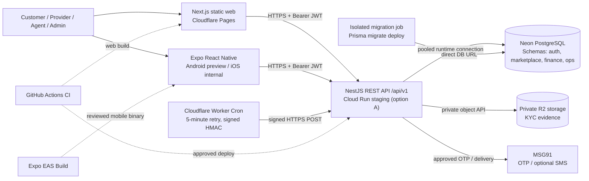
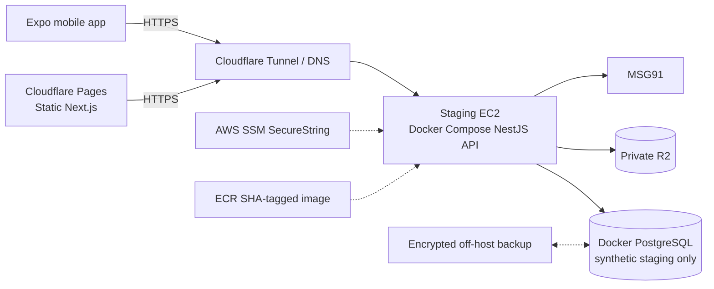

# Deployment topology and build pipeline

> **Reference architectures, not deployment verification.** Select one backend/database arrangement per environment and record the real URLs, account/tenant ownership and region outside the public repo.

## Option A: managed low-cost pilot staging


**Infrastructure requirements:** provision GCP project with billing/budget alerts, Cloud Run/Artifact Registry/Secret Manager; an isolated Neon PostgreSQL branch/project (direct connection for schema migration, pooled connection for runtime); Cloudflare Pages, private R2, HMAC Worker Cron; approved MSG91 SMS/OTP delivery; Expo EAS internal builds. Infra cost can exceed free-tier quotas. Sources: `apps/backend/infra/gcp/deploy-staging.sh`, `docs/LOW_COST_PILOT_RELEASE.md`.

**Deployment order:** (1) approve SHA and CI; (2) verify off-host backup + restore evidence; (3) provision only necessary secrets and exact CORS origins; (4) run isolated migration job against direct DB URL; (5) deploy API image pinned by SHA and verify database health; (6) build Cloudflare Pages with public API origin; (7) deploy Cron worker and test signed retries; (8) build Android preview APK and run multi-role real-device UAT.

**Build contract:** `NEXT_PUBLIC_API_BASE_URL` and `EXPO_PUBLIC_API_BASE_URL` are API **HTTPS origins** without `/api/v1`. Frontend static export is rebuilt after changing the URL. The web build root is the monorepo root; output `apps/web/out`. EAS preview builds an APK; production builds an AAB. Do not put a secret in a public environment variable.

## Option B: AWS EC2 staging, self-hosted database (test data only)


Sources: `apps/backend/infra/deploy.sh`, `apps/backend/infra/render-env.sh`, `apps/backend/docker-compose.prod.yml`, `docs/DEPLOYMENT_RUNBOOK.md`. Secrets live in SSM; ECR images are SHA-tagged; Cloudflare Tunnel provides HTTPS. The Compose database is suited to **synthetic staging**; replace with managed/backup-tested PostgreSQL for customer and financial data.

## Environment matrix
| Item | Local/CI | Controlled staging | Production (not certified) |
|---|---|---|---|
| API | Local NestJS / CI | Cloud Run or EC2, exact green SHA | Independently reviewed release |
| Web | Next local / static test | Cloudflare Pages | Separate project/origin |
| Mobile | Expo dev | EAS preview/internal APK | Signed EAS production release |
| DB | CI PostgreSQL 16 | Isolated Neon or synthetic Compose | Managed, encrypted, monitored PG |
| OTP | Stub/fixed only where explicitly safe | MSG91; restricted demo OTP only under exact documented gating | Approved real delivery |
| Money movement | Stub for dev tests | Disabled during provider-first pilot | Gate on #3, legal/finance approval |
| Secrets | Local ignored dotenv / CI secrets | Secret Manager / SSM / Expo | Separate keys, least privilege |
| Backups | Disposable | Encrypted off-host + restore rehearsal | Defined RPO/RTO and drills |

## Guarded release
For GCP staging only, reviewed operations may call `apps/backend/infra/gcp/deploy-staging.sh` with `APPROVE_STAGING_DEPLOY=YES`, `BACKUP_VERIFIED=YES`, `RELEASE_SHA=<green-sha>` and required cloud vars. For the EC2 alternative, use `apps/backend/infra/deploy.sh` with its explicit approval gate. Neither deploy script should be invoked merely to test documentation.

## Verification after deployment
```bash
curl --fail --show-error https://API-STAGING-ORIGIN/api/health
curl --fail --show-error https://API-STAGING-ORIGIN/api/health/db
# Verify the exact Pages build SHA, CORS preflight, role login and database migration status.
```

Record selected deployment platform, SHA, Pages build ID, EAS APK version, DB migration head, notification cron outcome, backup/restore proof, sign-off, and rollback owner in the release form. DNS, pricing, storage, DLT and legal setup require external account actions.

