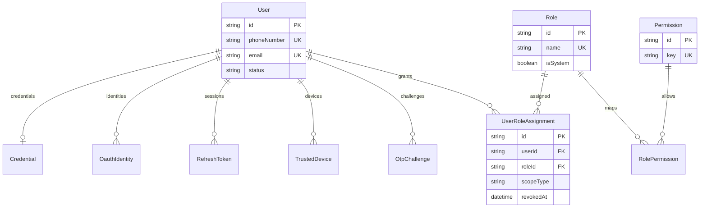
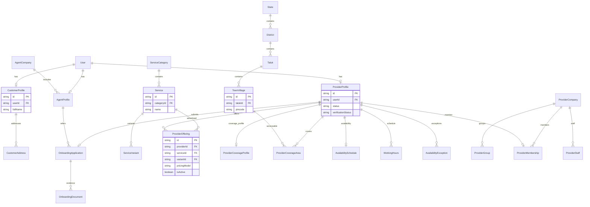
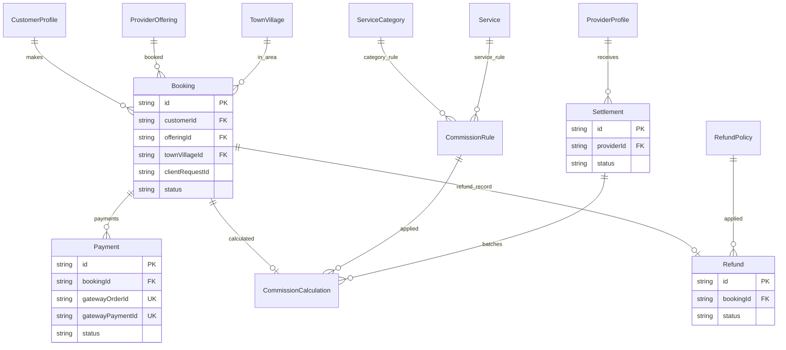
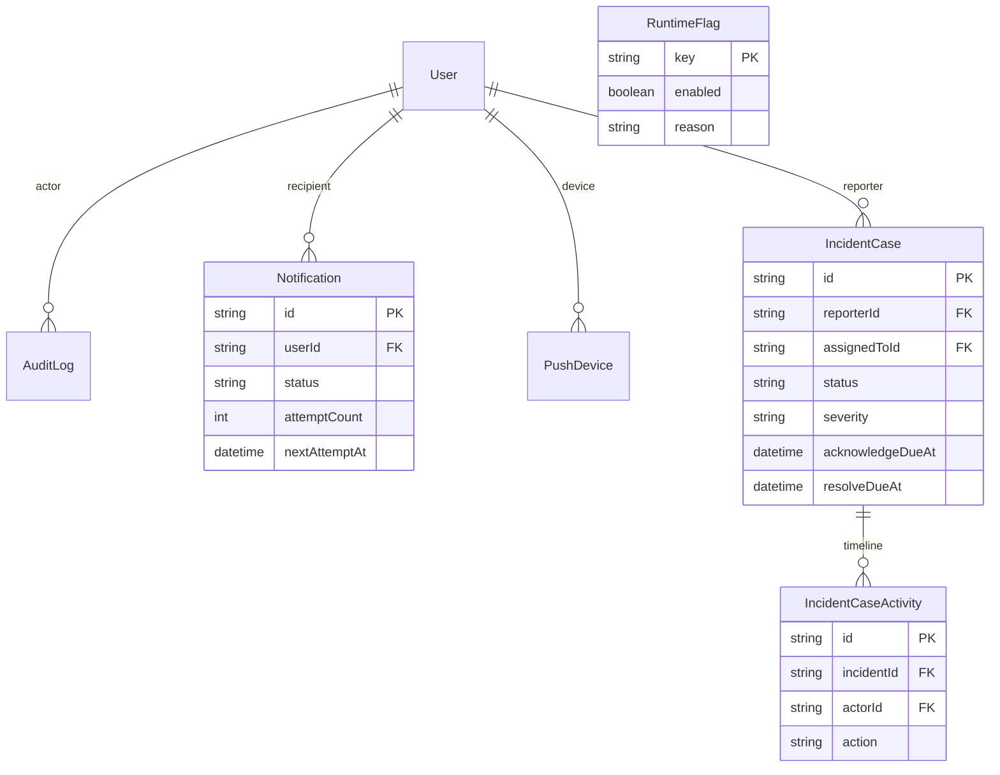

# Entity-relationship diagrams (Prisma/PostgreSQL)

**Actual baseline:** `apps/backend/prisma/schema.prisma` on `develop` (10 Nov 2026). These views focus on high-value relations; [DATABASE_CATALOG.md](DATABASE_CATALOG.md) includes **all 52 models, real table mappings and scalar fields**. Mermaid model names correspond to Prisma models; physical table names are listed in the catalogue. Nullable links are summarized rather than shown with every optionality nuance.

## Identity, roles and sessions — auth

## Marketplace: people, provider lifecycle, service catalogue, geography

## Booking and finance

## Operations, audit and incident cases

## Schema and integrity notes
- `auth`: identity, OTP, credentials, sessions, IAM grants. The RolePermission join implements many-to-many Role–Permission.
- `marketplace`: provider discovery joins verified active providers, offerings, service + geography, coverage/availability; a requested Booking references CustomerProfile, ProviderOffering and TownVillage.
- `finance`: Payment is many-per-Booking, with unique nullable gateway references; Refund and CommissionCalculation are **one per Booking** at baseline. Do not assume multiple partial refunds are represented.
- `ops`: Notification has delivery states, retry and lease fields; AuditLog append-only guard is in a migration; IncidentCase and activities are persisted but SLA automation requires issue #4.
- Some relationships cross PostgreSQL schemas (e.g. auth.User ↔ marketplace.CustomerProfile); **do not change foreign keys by hand**.
- Proposed FinancePriceRule/FinanceTaxRule/BillingInvoice entities are present only in unmerged PR #37; not shown as deployed/baseline here.

For export or deeper editing use `docs/diagrams/er-*.mmd`; GitHub already renders the blocks above.

